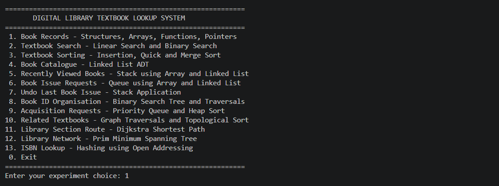
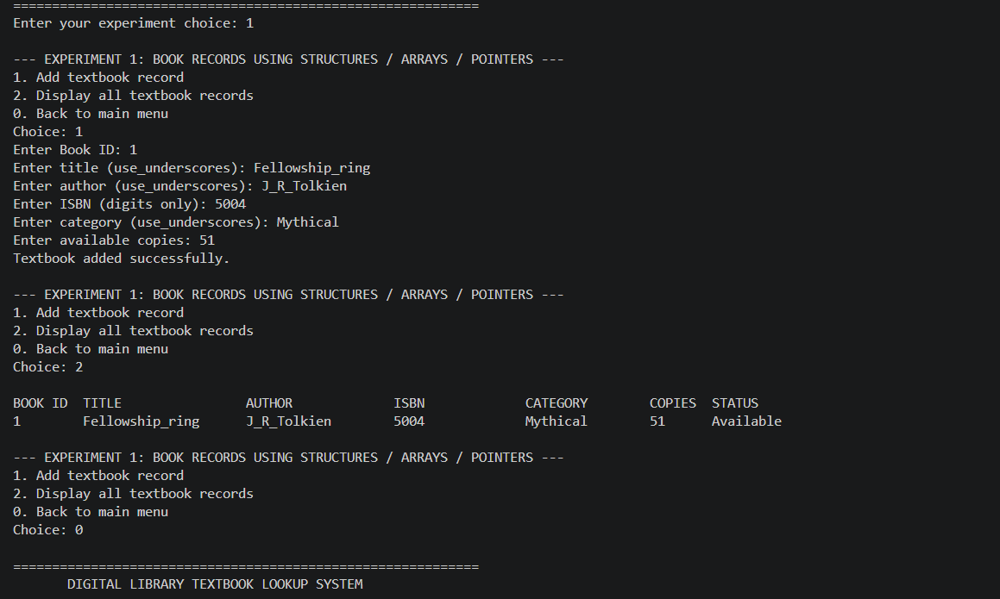
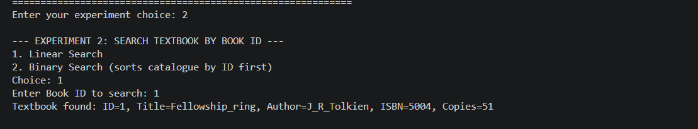

# DLib
A menu-driven Digital Library Textbook Lookup System developed in C, demonstrating 13 practical implementations of Data Structures and Algorithms, including Arrays, Linked Lists, Stacks, Queues, BST, Heaps, Graph Traversals, Dijkstra’s Algorithm, Prim’s MST, Sorting, Searching, and Hashing for efficient textbook management and retrieval.
# 📚 Digital Library Textbook Lookup System

A menu-driven **Digital Library Textbook Lookup System** developed using the C programming language. This project demonstrates the practical implementation of 13 different Data Structures and Algorithms (DSA) concepts through real-world library management operations.

The system provides functionalities for textbook cataloguing, searching, sorting, issue request processing, transaction management, priority scheduling, graph-based navigation, and ISBN lookup.

## 🚀 Project Overview

The Digital Library Textbook Lookup System simulates the core operations of an academic library using fundamental and advanced data structures.

It integrates linear and non-linear data structures along with various algorithms to provide efficient textbook management and retrieval.

## ✨ Features & Modules

The project consists of 13 modules:

| No. | Module | Concepts Used |
|---|---|---|
| 1 | Book Records Management | Structures, Arrays, Pointers, Functions & Macros |
| 2 | Textbook Searching | Linear Search & Binary Search |
| 3 | Textbook Sorting | Insertion Sort, Quick Sort & Merge Sort |
| 4 | Dynamic Book Catalogue | Singly Linked List |
| 5 | Recently Viewed Books | Stack using Array & Linked List |
| 6 | Book Issue Requests | Queue using Array & Linked List |
| 7 | Undo Last Book Issue | Stack Application |
| 8 | Book ID Organisation | Binary Search Tree & Tree Traversals |
| 9 | Priority Acquisition Requests | Priority Queue, Min-Heap & Heap Sort |
| 10 | Related Textbooks | Graph Traversals (DFS, BFS) & Topological Sorting |
| 11 | Library Section Navigation | Dijkstra's Shortest Path Algorithm |
| 12 | Library Network Optimisation | Prim's Minimum Spanning Tree Algorithm |
| 13 | ISBN Lookup | Hashing with Open Addressing & Linear Probing |

## 🛠️ Technologies Used

- **Programming Language:** C
- **Compiler:** GCC
- **Data Structures:** Arrays, Structures, Linked Lists, Stacks, Queues, Trees, Heaps, Graphs and Hash Tables.
- **Algorithms:** Searching, Sorting, Graph Traversal, Shortest Path and Minimum Spanning Tree.

## ⚙️ How to Run

### 1. Clone the Repository

```bash
git clone https://github.com/YOUR-USERNAME/Digital-Library-Textbook-Lookup-System.git
```

### 2. Navigate to the Project Directory

```bash
cd Digital-Library-Textbook-Lookup-System
```

### 3. Compile the Program

```bash
gcc main.c -o digital_library
```

### 4. Execute the Program

**Windows:**
```bash
digital_library.exe
```

**Linux / macOS:**
```bash
./digital_library
```

*Note: Replace `main.c` with the actual C source filename if it is different.*

## 📖 Learning Outcomes

Through this project, we explored:

- Implementation and manipulation of different data structures.
- Comparison of searching and sorting algorithms.
- Dynamic memory allocation and pointer manipulation.
- Stack and queue applications in real-world scenarios.
- Tree operations and hierarchical data organisation.
- Graph algorithms for navigation and network optimisation.
- Hashing techniques for efficient data retrieval.
- Memory management and cleanup in C.

## 🎯 Project Objective

The primary objective is to demonstrate how Data Structures and Algorithms can be applied to solve practical problems in an academic library environment while understanding their implementation, efficiency and time complexity.

## 👥 Project Team

Developed as an academic Data Structures and Algorithms laboratory project by a team of five students from the Department of Information Technology.

## 📌 Project Type

Academic Project | Data Structures & Algorithms | C Programming







## How to Compile and Run

### Prerequisites
- GCC compiler installed on your system.

### Compilation

Open a terminal in the project folder and execute:

```bash
gcc digital_library.c -o digital_library
```

### Execution

**Windows:**
```bash
digital_library.exe
```

**Linux / macOS:**
```bash
./digital_library
```

**Note:** Replace `main.c` with your actual C source filename if it is different.

---

⭐ If you find this project useful, consider giving the repository a star!
